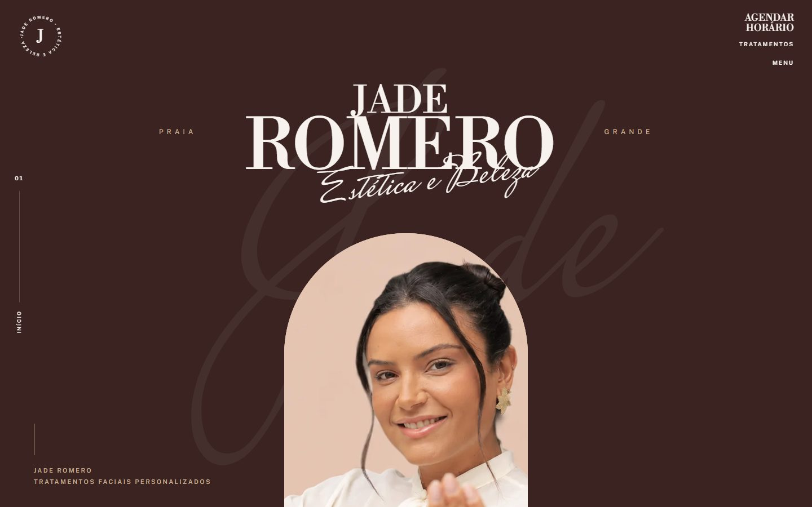
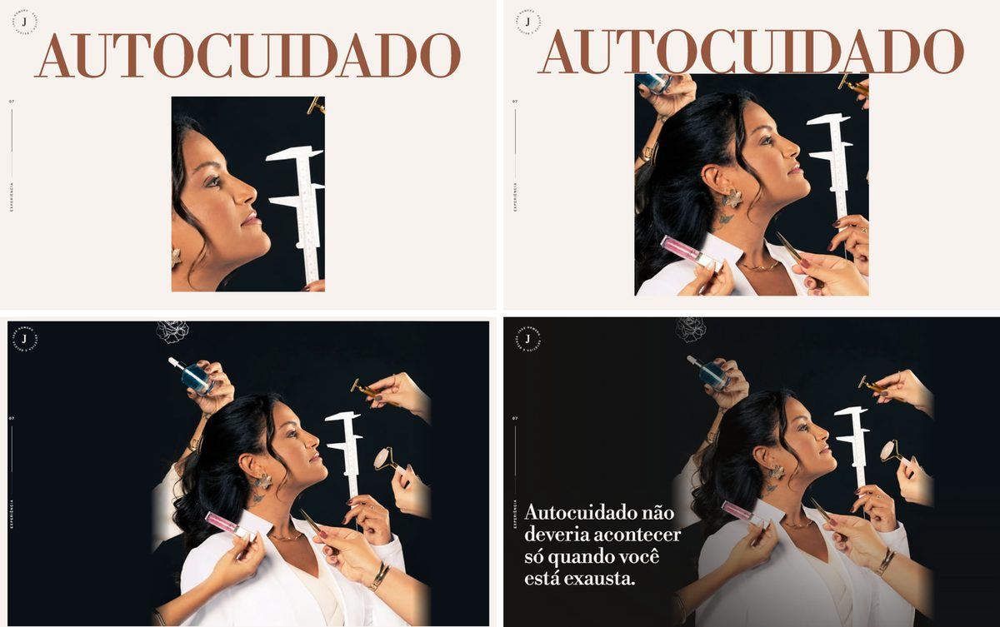
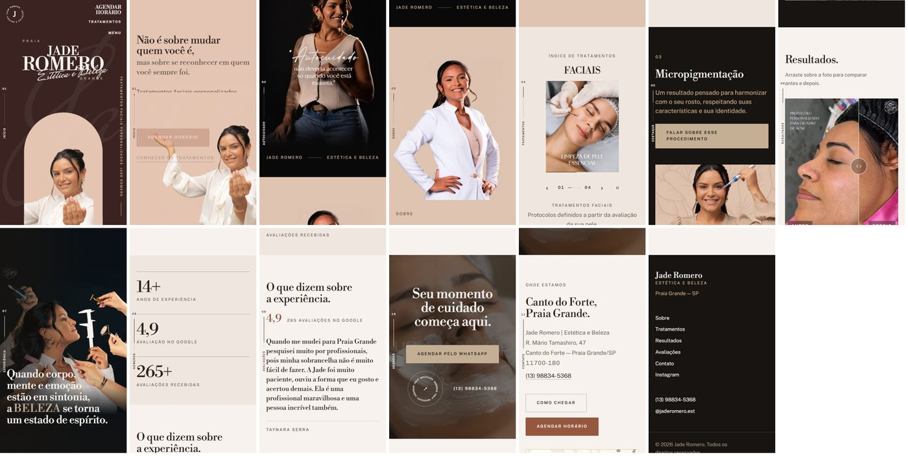
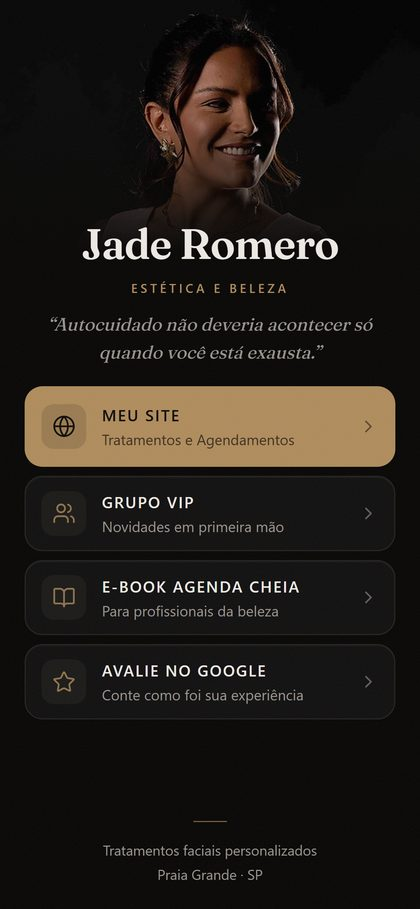

# Jade Romero | Estética e Beleza

Presença digital de **Jade Romero**, esteticista em Praia Grande/SP, especializada em
tratamentos faciais personalizados. O projeto tem duas entregas que trabalham juntas:
um **site institucional** e uma **página de links para a bio do Instagram**.

**Site:** https://jaderomero.vercel.app &nbsp;·&nbsp; **Bio:** https://jaderomero-estetica.netlify.app



---

## O site
 
Uma página única, editorial e contada pela rolagem. Cada seção apresenta um lado do
trabalho dela e todas levam ao mesmo lugar: o agendamento pelo WhatsApp.

| Seção | O que mostra |
|---|---|
| **Abertura** | O nome dela letra a letra e "Estética e Beleza" escrito à mão. Um arco se abre até revelar a Jade, e a frase dela sobe no espaço que sobra |
| **Manifesto** | A foto "Autocuidado", que nasce de uma cúpula escura ao final da abertura |
| **Sobre** | Quem é a Jade, 14 anos de atuação e o foco em tratamentos faciais personalizados |
| **Tratamentos** | Carrossel com os quatro tratamentos. Troca sozinho e pausa quando a pessoa interage |
| **Destaque** | Micropigmentação, em uma faixa escura com a foto dela |
| **Resultados** | Casos reais de antes e depois, comparados arrastando sobre a foto |
| **Autocuidado** | A foto abre de uma janela estreita até a tela inteira enquanto a página rola |
| **Números e avaliações** | Nota 4,9 no Google, 265 avaliações e depoimentos reais de clientes |
| **Agendar** | Chamada final sobre um vídeo dos atendimentos |
| **Onde estamos** | Endereço, mapa do perfil dela no Google e rota até o espaço |



### Experiência

- **Animações guiadas pela rolagem**, inspiradas em sites de alto padrão: textos que
  sobem linha a linha, fotos que entram por cortina e cenas presas à tela enquanto a
  história avança.
- **O mesmo site no celular.** Todas as animações rodam no celular, com o layout
  adaptado a telas de 320 a 430px de largura e revisado em telas baixas.
- **A voz é dela.** As frases de destaque são textos publicados pela própria Jade.
  Não há preço, prazo ou promessa inventados. As fotos de antes e depois são de
  clientes que autorizaram o uso das imagens.
- **Agendar está sempre a um toque.** O topo some ao rolar para baixo, para não cobrir
  o conteúdo, e volta no primeiro gesto para cima.



### Qualidade

- **Acessível.** O site funciona pelo teclado e com leitor de tela. Quem desativa
  animações no aparelho recebe o site completo, sem movimento. O carrossel automático
  tem botão de pausa.
- **Contraste medido, não estimado.** As cores foram amostradas das peças da marca
  dela e o texto foi conferido quadro a quadro, inclusive sobre o vídeo de fundo.
- **Leve.** O site publicado tem 3,3 MB. As imagens são WebP em dois tamanhos, e
  fotos e vídeo só carregam quando a pessoa chega até eles.
- **Testado como uma pessoa usaria.** Cliques, arrastes e rolagem com o dedo foram
  verificados com eventos reais do navegador, no computador e no celular.

---

## A bio



A página que fica no link da bio do Instagram. Leve, feita para abrir rápido dentro do
navegador do Instagram, com os links principais visíveis sem rolar:

- **Meu site**: o caminho para conhecer os tratamentos e agendar
- **Grupo VIP**
- **E-book Agenda Cheia**
- **Avalie no Google**

**A própria Jade atualiza os links** por uma planilha do Google, sem mexer em código.
Se a planilha ficar fora do ar ou tiver uma linha preenchida errada, a página usa os
links de reserva e nunca fica vazia. Links inseguros são bloqueados.

<br clear="right" />

---

## Tecnologias

| | |
|---|---|
| **Site** | React, Vite, GSAP (ScrollTrigger, SplitText) e Lenis, com CSS próprio baseado em tokens de design |
| **Bio** | HTML, CSS e JavaScript puros, em um único arquivo de cerca de 20 KB, com os links vindos do Google Sheets |
| **Hospedagem** | Vercel (site) e Netlify (bio), ambos com HTTPS |

## Estrutura

```
site/      site institucional
bio/       página de links da bio
entrega/   materiais entregues à cliente (manuais, planilha, mockups)
docs/      imagens deste README
```

---

Desenvolvido por **Matheus Yamauti** para Jade Romero | Estética e Beleza.
